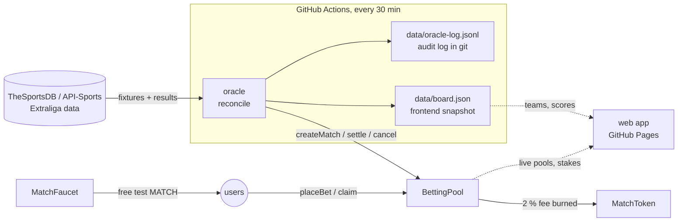

# Hockey Prediction Market on Ethereum (Czech Extraliga)

A token-engineering project: an ERC-20 token (**MATCH**), a parimutuel prediction
pool on real ice-hockey matches, and an autonomous oracle that keeps the chain in
sync with the real world. Runs on **Sepolia testnet only**.

> ⚠️ **Educational project. MATCH has no monetary value**, cannot be bought, and is
> handed out for free by a faucet. It is never to be deployed to mainnet or listed
> on an exchange: real-money betting requires a gambling licence (in Czechia under
> Act No. 186/2016 Coll.).

**Live app: https://blav08.github.io/extraliga-onchain-prediction-market/**

## Deployed contracts (Sepolia)

| Contract | Address |
|---|---|
| MatchToken | [`0xb459…7512`](https://eth-sepolia.blockscout.com/address/0xb459280925651b0a4ee6b1f71C88C87cc1787512) |
| BettingPool | [`0x684C…a7Af`](https://eth-sepolia.blockscout.com/address/0x684C429c009088b2Ed69410d8e974aec5b4fa7Af) |
| MatchFaucet | [`0xA3e7…DC9E`](https://eth-sepolia.blockscout.com/address/0xA3e78CD63AE1F6C6D8b4E12B3730C725E561DC9E) |

## How it fits together



## Data sources

The oracle talks to providers only through a `Source` interface (`oracle/sources.py`),
so the provider is a config switch, not a code change.

| `SOURCE` | Cost | Coverage (checked 2026-11-06) |
|---|---|---|
| `thesportsdb` (default) | free, key `123` | current season, **max 3 games per matchday**; results re-checked per game via `lookupevent` |
| `thesportsdb` + premium key | $9 / month | full schedule, same code |
| `apisports` | paid | full schedule; free plan only serves seasons 2022–2024 |
| `file:path.json` | free | offline demo and tests |

Because free schedules are partial, every market the oracle has opened is re-checked
individually; the list of open markets is rebuilt from the oracle's own audit log.

## The oracle: design decisions

**Stateless reconciliation.** Every run compares *desired state* (what the data
provider says) with *actual state* (what the contract says) and emits the minimal
set of transactions to close the gap, like a Kubernetes controller. The chain is
the only state: no database, a crashed or skipped run is harmless, and running
twice does nothing twice.

**Pure planner.** All decisions live in `oracle/planner.py`, a side-effect-free
function `plan(fixtures, chain_state, now) -> actions`. That makes every rule
unit-testable in milliseconds.

**Integrity rules worth knowing:**

| Situation | Oracle does |
|---|---|
| Game scheduled within 7 days, ≥ 15 min ahead | create market, betting closes at kick-off |
| Game final (`FT`, `AOT`, `AP`, `AW`) | settle; market is winner incl. OT and shootout |
| Postponed / cancelled / abandoned | cancel → everyone refunded |
| Kick-off moved **earlier** than on-chain close | cancel (otherwise people could bet on a running game) |
| Shootout result level with no shootout data | refuse to guess, log `NEEDS HUMAN` |
| Unknown provider status code | treat as uncertain, do nothing |
| Oracle silent for 3 days after kick-off | anyone can call `cancel` on chain → refunds |

**Safety rails for an unattended key:** every transaction is simulated with
`eth_call` first (a revert costs nothing), nonces are managed explicitly, fees are
capped, a run sends at most `MAX_TX_PER_RUN` transactions, and the oracle key holds
only `ORACLE_ROLE` (it cannot mint, pause or move anyone's tokens).

**Transparency log.** Each decision is appended to `data/oracle-log.jsonl` together
with the raw evidence (provider status, score, shootout line) and the tx hash, and
committed to git. Git history makes it tamper-evident: anyone can check every
settlement against what the data source actually reported.

**Deterministic match IDs.** `matchId = keccak256("apisports-hockey:<fixtureId>")`.
Anyone can recompute the on-chain ID from a public fixture ID; no lookup table.

### Trust model (honest limitations)

- The oracle is **centralized**: one key decides results. Mitigations: limited role,
  public audit log, on-chain timeout refund. A decentralized design (e.g. optimistic
  oracle with a dispute window, or Chainlink Functions) is future work.
- Data comes from a single provider. A wrong score from the provider becomes a
  wrong settlement.
- The pool rounds payouts down; the dust stays in the contract.

## Run it

```bash
pip install -r requirements.txt
cp .env.example .env              # fill in ORACLE_PRIVATE_KEY (rest has working defaults)
python -m oracle run --dry-run       # see what it would do, sends nothing
python -m oracle run                 # do it
python -m oracle status              # chain state of nearby fixtures
```

Offline demo without an API key: `SOURCE=file:tests/fixtures/sample_games.json`.

### GitHub Actions setup

1. **Secrets** (Settings → Secrets and variables → Actions → *Secrets*):
   `ORACLE_PRIVATE_KEY`, `RPC_URL` (optional: `THESPORTSDB_KEY`, `APISPORTS_KEY`)
2. **Variables** (same page → *Variables*): `POOL_ADDRESS` (optional: `SOURCE`, `LEAGUE_ID`, `SEASON`)
3. Actions tab → *oracle* → **Run workflow** with `dry_run` ticked first.

Note: GitHub disables scheduled workflows after 60 days without repository
activity. The oracle's own commits to `data/` count as activity.

## Web app (`docs/`)

A static page served by GitHub Pages, plain JavaScript + ethers v6, no build step.

- Every game is drawn as a rink: home end on the left, away end on the right, the red
  line between them. A team's pool share fills its half from the red line outwards and
  the centre circle shows the countdown, or the final score.
- **The chain is the source of truth.** `board.json` (from the oracle) only supplies team
  names, crests and scores; pools, stakes, results and claimable amounts are read live
  from the contracts.
- **Few wallet prompts:** the first bet asks for a one-time ERC-20 allowance (capped at
  10,000 MATCH, not unlimited), every later bet is a single transaction. An earlier version
  used EIP-2612 permit signatures (one transaction per bet), but wallet security layers
  (MetaMask / Blockaid) treat off-chain Permit signatures as the classic wallet-drainer
  pattern and stacked several warnings on every bet. The contract still exposes
  `placeBetWithPermit` for integrators.
- The account holding `ORACLE_ROLE` cannot bet from the web app: whoever settles games
  must not hold a stake in them.
- The payout preview uses the contract's own formula, including the 2 % burn.
- Third-party data is rendered as text only (no `innerHTML`), and contract addresses
  cannot be overridden from the URL, so a crafted link cannot point a wallet elsewhere.

## Tests

```bash
python -m pytest -q
```

- `test_sources.py`: status mapping, winner logic incl. OT/shootout edge cases
- `test_thesportsdb.py`: TheSportsDB field shapes, postponement flag, audit-log recovery
- `test_planner.py`: every rule in the table above, idempotency, action ordering
- `test_e2e_localchain.py`: the real oracle drives the real contracts on an
  in-memory EVM through a full matchday (create → bets → postponement →
  shootout → settlement with burn → refunds → board + audit log)

- `tests/frontend/`: the real page driven by headless Chrome against the real contracts on a
  local node with Sepolia's chain id: connect, faucet, first bet (approve + bet) and second
  bet (exactly one wallet prompt), collect winnings and refund, over-balance guard, and an XSS probe in a team name.
  ```bash
  cd tests/frontend && npm i hardhat@2 && npx hardhat node        # terminal 1
  python tests/frontend/setup_chain.py                             # terminal 2
  python -m http.server 8765 -d docs &  python tests/frontend/ui_flow.py
  ```

Contracts: `contracts/`. Recompile with `node scripts/compile.js`
(needs `npm i solc@0.8.24 @openzeppelin/contracts@5`).
